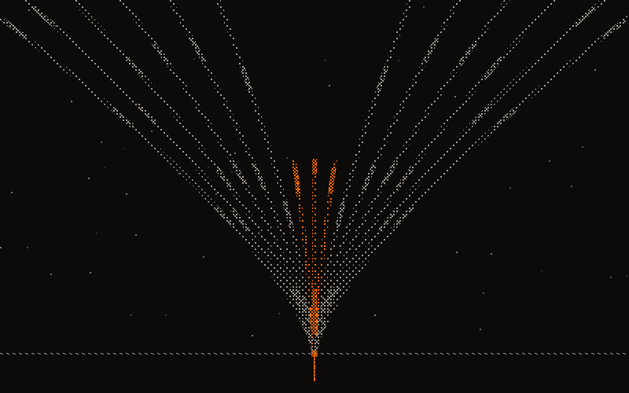
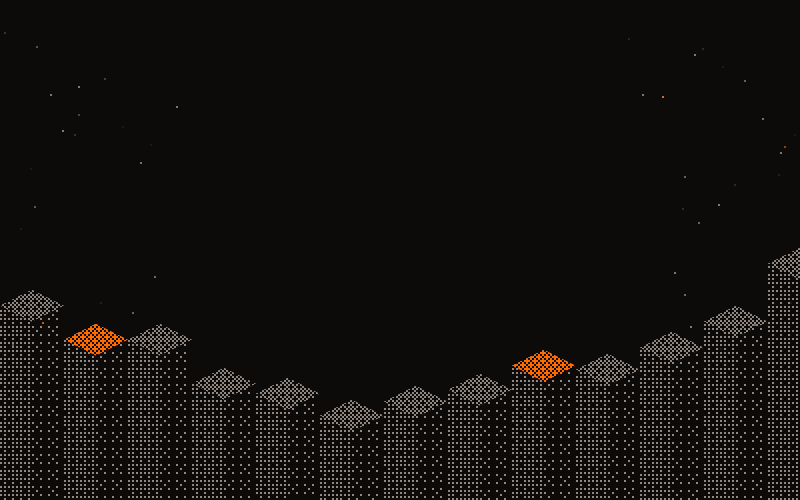

# Isometric dither

A dithered theme for Claude Code on desktop, in Isometric's colours.

**Funnel**



**Blocks**



## Install

```
claude plugin install isometric-dither --marketplace isometricfi/claude-theme
```

## Switch scenes

```
/isometric-theme funnel
/isometric-theme blocks
```
